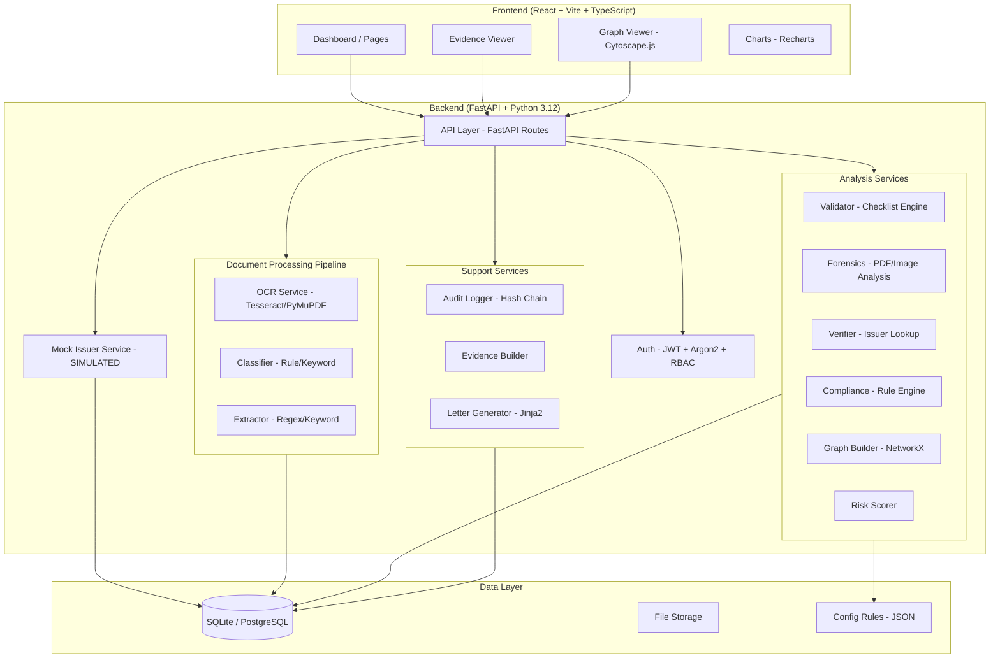
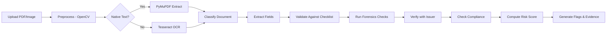
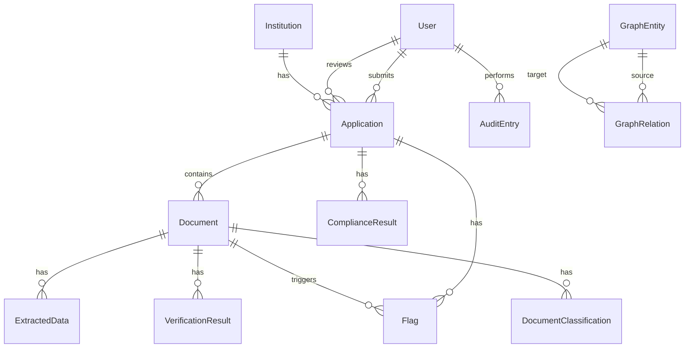

# AICTE-Verify Architecture

## Overview

AICTE-Verify is a decision-support platform for AICTE officers that validates institution applications and supporting documents using AI-powered analysis. **All AI output is advisory only; human officers make every final decision.**

## System Architecture

## Pipeline Flow

## Module Responsibilities

| Module | Responsibility | Status |
|--------|---------------|--------|
| `core/config.py` | Application settings from .env | Implemented |
| `core/database.py` | SQLAlchemy engine, session, Base | Implemented |
| `core/security.py` | JWT auth, password hashing, RBAC, PII masking | Implemented |
| `core/audit.py` | Append-only audit chain with SHA-256 integrity | Implemented |
| `services/ocr/` | OCR pipeline: preprocess → extract text | Implemented |
| `services/classify/` | Rule+keyword document type classification | Implemented |
| `services/extract/` | Field extraction via regex + keyword anchoring | Implemented |
| `services/validate/` | Checklist validation, cross-doc consistency | Implemented |
| `services/forensics/` | PDF metadata, font analysis, ELA, copy-move, signatures, duplicates | Implemented |
| `services/verify/` | Verification adapter + mock issuer integration | Implemented |
| `services/compliance/` | Infrastructure norms, photo checks, capacity calculator | Implemented |
| `services/graph/` | Knowledge graph: ghost faculty, shared land/trust detection | Implemented |
| `services/risk/` | Weighted risk scoring with breakdown | Implemented |
| `services/letters/` | Jinja2 deficiency letter generation + optional Gemini | Implemented |
| `services/evidence/` | Evidence page rendering with highlights & overlays | Implemented |
| `mock_issuer/` | SIMULATED issuing authority verification service | Implemented |

## Simulated vs Real Components

| Component | Current Status | Real Integration Path |
|-----------|---------------|----------------------|
| Issuer verification | **SIMULATED** mock service | Replace adapter with real API clients |
| University affiliation check | **SIMULATED** | Integrate with university systems |
| Fire safety verification | **SIMULATED** | Connect to state fire department APIs |
| Accreditation check | **SIMULATED** | Connect to NBA/NAAC systems |
| Outside signals (A8) | **SIMULATED** local JSON | Connect to real accreditation/ranking databases |
| OCR | Real (Tesseract) | Could upgrade to cloud OCR for better accuracy |
| Forensics | Real (heuristic) | Could add ML-based forgery detection |
| Digital signatures | Real (pyHanko) | Works with real PKI certificates |

## Security Model

- **Authentication**: JWT tokens with configurable expiry
- **Password Storage**: Argon2 hashing (OWASP recommended)
- **Authorization**: Role-based access control (admin, officer, college_user)
- **PII Protection**: Automatic masking of Aadhaar-like numbers and phone numbers
- **Audit Trail**: Append-only with SHA-256 hash chain for tamper detection
- **Upload Security**: Type validation, size limits, filename sanitization

## Data Model

## Future Scope (Not Implemented)

- **Satellite imagery verification**: Cross-reference campus images with satellite data
- **Full native inspector app**: Mobile app for physical inspection workflows
- **Real DigiLocker integration**: Verify documents through DigiLocker API
- **Real university system integration**: Direct affiliation verification
- **Real AICTE system integration**: Pull application data from AICTE portal
- **ML-based document classification**: Deep learning model for complex layouts
- **Advanced forgery detection**: GAN-based or deep learning forgery detectors
- **Multi-language NLP**: Named entity recognition for Indian languages
- **Workflow automation**: Automated routing and escalation based on rules
- **Digital certificate issuance**: Issue verified certificates with digital signatures
